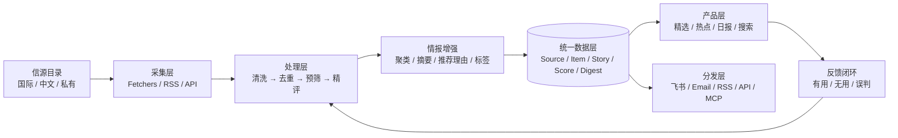

# IC · 情报中心

> 反向加载团队的全球科技情报中心（Tech Intelligence Center）基础仓库。

IC 希望把分散在全球官方博客、研究社区、技术媒体、GitHub、RSS 与中文内容平台中的高价值信息，整理成**更少、更准、可解释、可追溯**的科技情报，并同时服务人类阅读和 Agent 消费。

> [!IMPORTANT]
> 项目目前处于调研与技术选型阶段。这里是独立的基础仓库，不是 Horizon、AIHOT 或其他项目的 fork；在完成架构、许可证与数据合规评估前，不预设最终实现。

## 产品目标

第一阶段聚焦 AI / 前沿科技动态，跑通从采集到分发的最小闭环：

- 聚合可信的国内外信息源，而不是无差别抓取全网；
- 通过低成本预筛和强模型精评降低噪声；
- 为每条精选提供中文摘要、推荐理由、评分和原始信源；
- 将同一事件的跨源报道合并为可追踪的 Story；
- 产出精选流、日报，以及 RSS / API / Agent 可消费的数据；
- 通过人工反馈持续校准信源等级和评分策略。

长期目标是演进为支持团队协作、私有信源与私有部署的产品，但当前优先解决“团队每天真正愿意读什么”。

## 产品原则

1. **质量优先于数量**：信源质量和筛选质量比信源规模更重要。
2. **结论必须可追溯**：摘要、评分和推荐理由都要能回到原文与证据。
3. **国内外信息同等重要**：微信公众号等中文源是一等公民，但采集方式必须合规、可维护。
4. **模型分层使用**：便宜模型处理高频粗筛，强模型用于少量高价值内容的精评与生成。
5. **先复用，再改造**：优先组合成熟开源能力，不从零重写聚合器。
6. **面向人，也面向 Agent**：Web 与日报之外，数据模型要原生支持 API、RSS、Skill 和 MCP。

## 初步选型判断

以下结论基于 2026-08-19 的公开仓库与页面观察，仍需通过代码级调研和原型验证。

| 项目 | 当前角色判断 | 已确认优势 | 主要待验证项 |
| --- | --- | --- | --- |
| [AIHOT](https://aihot.virxact.com/) | 产品与品味标杆，不作为可 fork 底座 | 已呈现精选、全部动态、热点、日报、主题、模型榜和 Agent 接入；公开 RSS、API 与 OpenAPI | 字段与聚类细节、接入限制、商业使用条款 |
| [Horizon](https://github.com/Thysrael/Horizon) | 主引擎首选候选 | MIT；Python；覆盖 RSS、HN、Reddit、Telegram、X、GitHub 等；具备去重、AI 评分/过滤、增强、双语简报、飞书等 Webhook 与 MCP | 持久化、跨源事件聚类、多阶段模型路由、反馈闭环和中文源扩展成本 |
| [ai-news-aggregator](https://github.com/SuYxh/ai-news-aggregator) | 中文源与前端交互参考候选 | 国内平台与公众号源较丰富；React 信息流；结构化 JSON；GitHub Actions 定时更新 | 公众号来源与合规性、源配置可迁移性、许可证状态、作为上游 Feed 的稳定性 |

当前工作假设是：**以 Horizon 的处理管线为主要候选，吸收中文源项目的源配置与产品经验，在 IC 内形成独立的数据模型和产品层。** 这不是最终选型结论。

## 目标架构草案

计划中的核心实体：

- `Source`：信源身份、类型、语言、等级、授权与健康状态；
- `Item`：一次采集得到的原始内容及规范化结果；
- `Story`：同一事件或主题下的一组跨源 `Item`；
- `Score`：带维度、模型、提示词与策略版本的评分记录；
- `Digest`：精选、日报或周报等可发布产物。

## MVP 边界

第一阶段只做：

- AI / 前沿科技动态；
- 一批经过人工审核的国内外信源；
- 增量采集、去重、预筛、多维评分；
- 中文摘要与推荐理由；
- 精选流和日报；
- 飞书或邮件中的一种推送；
- 基础 RSS / API；
- 最小反馈字段与运行可观测性。

第一阶段不做：全网爬虫、通用新闻门户、企业级权限、复杂计费、完整报告 PDF 管线，也不复制或转售 AIHOT 数据。

## 当前研究队列

1. 拆解 AIHOT 的信息架构、字段、公开接口与使用条款；
2. 代码级审查 Horizon 的模块、配置、数据流、存储、调度和扩展点；
3. 审查 `ai-news-aggregator` 的公众号链路、数据结构、许可证与可迁移性；
4. 横向比较其他活跃候选，形成底座选型记录；
5. 定义 `Source / Item / Story / Score / Digest` 的最小数据契约；
6. 用真实中英文信源做一条端到端 tracer bullet；
7. 再据验证结果确定 fork、组合或独立适配层方案。

## 验收方向

选型阶段结束时，应能回答：

- 每类信源如何合法、稳定地进入系统？
- 一条内容如何从原始记录变成可解释的精选或 Story？
- 哪些能力直接复用，哪些通过适配层扩展，哪些必须自研？
- 日处理 500–2,000 条时的质量、延迟、模型成本和运维复杂度如何？
- 上游项目、数据源和生成内容的许可证及商业化边界是什么？

## 合规与使用边界

- 尊重站点 ToS、robots、访问频率、版权和转载规范；优先使用官方 API、RSS 或明确授权渠道。
- 微信公众号内容默认只保存检索、去重与摘要所需的最小数据，并保留原文链接；具体方案须经专项合规评估。
- AI 生成的摘要和推荐理由不是事实来源，产品展示必须保留原始信源和不确定性。
- 引入任何开源代码、源清单或数据前，分别核验其代码许可证、内容授权与商用条件。
- 本仓库为团队内部私有项目；未经团队确认，不公开内部信源、凭据、评分策略或采集数据。

## 项目状态

**阶段：Discovery / 选型调研。** 当前仓库先承载研究结论、架构决策、实验和后续实现；技术栈与上游底座尚未最终确定。

