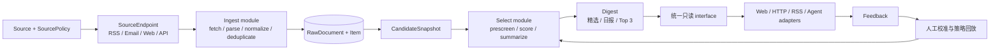

# IC · 情报中心

> 反向加载团队的全球科技情报中心（Tech Intelligence Center）基础仓库。

IC 希望把分散在全球官方博客、Newsletter、研究社区、技术媒体、GitHub、RSS 与中文内容平台中的高价值信息，整理成**更少、更准、可解释、可追溯**的科技情报，并同时服务人类与 Agent。

> [!IMPORTANT]
> 项目处于 Discovery。这里是独立基础仓库，不是 Horizon、AIHOT 或其他项目的 fork；在 interface、许可证、来源风险和 tracer bullet 验证完成前，不预设最终实现。

## P0 产品目标

第一阶段只验证一条足够小、足够深的闭环：

- 维护一批已登记并配置 `SourcePolicy` 的国内外 `Source` 及其可替换 `SourceEndpoint`；
- 增量采集并保存不可变原始记录，将内容幂等归一化为 `Item`；
- 低成本预筛、版本化评分和强模型精评；
- 生成包含中文摘要、推荐理由、分数与回源链接的 `Digest`；
- 以同一只读 interface 支持 Web、HTTP、RSS 和后续 Agent adapter；
- 接受“有用 / 无用 / 误判”反馈，进入可审计的人工校准流程。

P0 首先回答：团队是否真的愿意每天阅读 Digest，它是否稳定减少噪声，并且每个结论能否回到原始来源。

## 产品原则

1. **质量优先于数量**：信源质量和筛选质量比信源规模更重要。
2. **结论必须可追溯**：摘要、评分和推荐理由都必须回到 `Item` 与原始 provenance。
3. **国内外来源同等重要**：中文源遵守与国际源相同的 interface、健康监控和 `SourcePolicy`，不因接入方式特殊而绕过保留、删除和凭据规则。
4. **模型分层使用**：便宜模型处理高频预筛，强模型只处理少量高价值候选。
5. **先复用，再改造**：在真实 seam 复用开源实现，不让上游模型污染 IC 的领域 interface。
6. **一个只读能力面**：Web、HTTP、RSS、MCP 与 Skill 是传输 adapter，不分别实现搜索、排序或 Digest 逻辑。

## 分期

| 阶段 | 产品闭环 | 规范实体 |
| --- | --- | --- |
| P0 | 可信采集 → 可回放筛选 → 可解释 Digest → Feedback | `Source`、`SourceEndpoint`、`SourcePolicy`、`RawDocument`、`Item`、可选 `Issue`、`CandidateSnapshot`、`Score`、`Digest`、`Feedback` |
| P0.5 | 跨源事件聚类 | `Story` |
| P1 | 经人工接受的 Claim 编译为长期知识 | `Claim`、`KnowledgeCard`、`KnowledgeIndex` |
| P2 | 知识本体和多租户商业能力 | `Concept`、`OpenQuestion`、多租户 `WorkspaceSubscription` |

Story 不再是 P0 生成 Digest 的前置条件。Newsletter/Wiki 调研验证的是长期机会；知识编译不会与日报产品同时进入 P0。

规范字段、ID、去重、不变量与默认全文保留策略见 [P0 规范数据契约](./docs/specs/p0-domain-contract.md)；项目领域词汇见 [IC 领域语言](./CONTEXT.md)。

## P0 信息流与 seam

P0 只有两个核心写入 module：

- `Ingest.ingest(endpoint) → IngestResult`：隐藏抓取、原始保存、解析、规范化、确定性去重、provenance、检查点与失败恢复；
- `Select.create_candidate_snapshot(scope) → snapshot` 与 `Select.select(snapshot, policy, purpose) → Digest`：持久化封闭候选集，隔离发布与策略回放，隐藏预筛、评分、摘要、推荐理由与幂等。

`worker`、队列和时钟是运行拓扑，不是领域 module。P1 的 `Compile` 只有在团队形成稳定的 Digest 阅读、Claim 接受和 Wiki 审核行为后才建立。

## 候选项目判断

以下结论基于 2026-08-19 的公开仓库、源码和页面观察。

| 项目 | 当前角色 | 可复用或借鉴 | 限制 |
| --- | --- | --- | --- |
| [AIHOT](https://aihot.virxact.com/) | 产品与数据契约标杆 | Item/Story/Digest 体验、REST/RSS/MCP/Skill 同源只读契约 | 不作为可 fork 底座；对外商业数据使用需要书面授权 |
| [Horizon](https://github.com/Thysrael/Horizon) | Ingest 内部 adapter/implementation 的优先验证候选 | 部分 fetcher、解析工具、模型 provider routing | `ContentItem`、评分语义和整条 pipeline 不构成 IC interface；无数据库、常驻调度、反馈和产品层 |
| [ai-news-aggregator](https://github.com/SuYxh/ai-news-aggregator) | 中文源发现与 UI/静态 Feed 参考 | 53 个公众号候选、快照思路、轻量信息流 | 公众号全部依赖单一第三方镜像、时间可能失真、无正式 LICENSE，不直接复制代码或依赖数据 |

Horizon 的 seam 已下移到 `Ingest` implementation 内部：`FetchAdapter.fetch(endpoint) → RawDocument`。第一发固定使用 Native RSS 作为第二个生产 adapter；两者通过同一 Ingest 契约测试后，才能宣称 Horizon 可替换。

## P0 候选范围

包含：

- AI / 前沿科技动态；
- 已登记并配置 `SourcePolicy` 的 Source 与 Endpoint；
- 至少一个国际来源和一个可持续中文来源；
- 增量 Ingest、确定性去重和逐源运行状态；
- 预筛、版本化 Score、中文摘要和推荐理由；
- 持久化 CandidateSnapshot 与可回放策略评估；
- Digest（精选、日报或 Top 3 的统一产物）；
- 一种主动推送；
- HTTP/RSS 读取与最小 Feedback；
- 模型、策略、成本、失败和 provenance 可观测性。

不包含：

- 全网无差别爬虫、通用新闻门户；
- Story 产品化和自动事件合并；
- Claim/Wiki/index-first 写作；
- 企业权限、复杂计费与多租户；
- 完整 PDF 报告管线；
- 未通过稳定性、多上游和来源风险验证的微信公众号生产 connector；
- 复制或转售 AIHOT 数据。

微信公众号是重要目标，但是否进入 P0 仍是显式开放问题。无论阶段如何，不使用单一个人 RSS 镜像作为唯一生产依赖。

## Agent 读取面

P0 的目标能力面先定义同一只读语义，而不是为每种传输重写逻辑：

- `search`
- `get_item`
- `list_digests`
- `get_digest`

`get_story` 只在 Story 进入 P0.5 后增加。MCP、Skill 和 HTTP 都只是这组能力的 adapter；读取路径不得同步调用 LLM。

当前第一发 tracer bullet 只实现并验证 `get_item` 与 `get_digest`；`search`、`list_digests`、RSS 投影和第二个读取 adapter 在第一发通过后补齐，不把它们伪装成已交付能力。

## 当前验证队列

1. 将 [P0 数据契约](./docs/specs/p0-domain-contract.md) 冻结为本轮验证基线，状态仍保持 `Draft`；
2. 按 [P0 第一发 tracer bullet](./docs/plans/p0-tracer-bullet.md)，用 OpenAI 官方 RSS 与 Horizon Hacker News 跑通 `Ingest → Snapshot → Select → Digest → Feedback`；
3. endpoint health 第一发只进入 `IngestResult`、日志和指标，不新增 ops interface；
4. 根据 tracer bullet 结果确定 Horizon 的引入方式：内部 fork、提取低层 fetcher，或按 interface 重写；
5. 再单独验证可持续中文来源、Email 和 PostgreSQL-backed queue；
6. 运行 500 / 1,000 / 2,000 条每日负载与成本实验；
7. 团队连续使用 Digest 后，再决定 Story 和 Compile 是否立项。

研究证据与历史假设见 [`docs/research`](./docs/research/README.md)。

## 技术决策

- [ADR-0001：后端主语言与运行形态](./docs/decisions/0001-backend-language-and-boundary.md) — `Proposed`
- [ADR-0002：P0 范围与深模块 interface](./docs/decisions/0002-p0-scope-and-module-interfaces.md) — `Proposed`
- [ADR-0003：内部研究的数据使用姿态](./docs/decisions/0003-internal-research-data-use-posture.md) — `Accepted`
- [P0 规范数据契约](./docs/specs/p0-domain-contract.md) — `Draft`
- [P0 第一发 tracer bullet](./docs/plans/p0-tracer-bullet.md) — `In validation`

## 内部使用与来源风险

- 当前只服务反向加载团队的内部研究。P0 不把逐源重型法律审查设为 tracer bullet 前置条件；`SourcePolicy` 是可执行的采集、保留、展示和删除配置，不是“已经获得授权”的证明。
- 内部可以共享标题、摘要、短摘录、回源链接和派生分析。原始/规范全文只用于受控处理与短期复核，默认最多保留 7 天，不做常驻全文镜像。
- 优先官方 API、RSS；公开页面确需抓取时保持低频、有界并发，不绕过登录、付费墙、CAPTCHA 或其他访问控制。
- 凭据只保存引用并与内容隔离；来源停用或收到删除请求时，系统必须能删除 payload 并保留最小 tombstone。
- “项目私有、外部无人知晓”不是风险控制。任何公开发布、收费、客户交付、镜像、批量再分发或外部 RAG/模型用途，都必须先经过新的来源与用途复核。
- AI 生成内容不是事实来源，产品展示必须保留原始信源、版本和不确定性。
- AIHOT 可用于同一组织内部情报；任何对外收费、客户交付、代理、镜像、批量再分发或外部 RAG/模型产品必须先获书面授权。
- 本仓库为团队内部私有项目；未经确认，不公开内部信源、凭据、评分策略或采集数据。

## 最小 Web 工作台

运行 API 后访问根路径 `/` 即可进入团队内部工作台。首页展示来源接入概览、最近采集的 Item 与已发布 Digest；Item 详情提供原文和 provenance，Digest 详情提供推荐理由及“有用 / 无用 / 误判”反馈。

工作台只消费 `ReadIntelligence` 读取面，页面渲染不会现场重新采集、打分或调用模型。Ingest、Snapshot 和 Digest 生成仍由 CLI、调度器或受控 API 触发，避免一次浏览请求意外启动写入管线。

## 项目状态

**Discovery / tracer bullet 实施。** 已按 Draft 契约建立 FastAPI + PostgreSQL 垂直切片和最小内部 Web 工作台，用于验证两个真实 adapter、Snapshot、Digest、读取与 Feedback；它不是完整 MVP，暂不包含模型精评、任务队列、Email 或中文 connector。开发服务器操作见 [Runbook](./docs/runbooks/development-server.md)。
