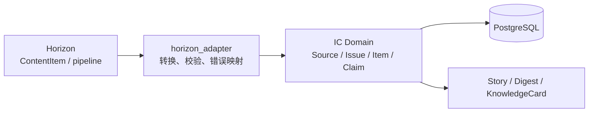

# ADR-0001：后端主语言与 Horizon 集成边界

- 状态：Proposed
- 日期：2026-08-19
- 决策范围：IC MVP 后端技术栈与 Horizon 集成方式

## 背景

IC 需要同时处理 RSS、Newsletter/Email、网页、GitHub、中文内容源、PDF，以及 LLM 评分、Claim 抽取、Story 聚类和知识编译。

首轮调研确认：Horizon 是 Python 3.11 的批处理采集与 AI 加工管线，适合作为 worker 或参考实现，但不具备 IC 所需的数据库、可靠调度、检索、多人协作、权限和产品层。

MVP 预计每天处理 500–2,000 条内容。当前主要瓶颈会来自上游网络、内容解析和模型调用，而不是 Web API 的纯计算吞吐。

## 建议决策

### 1. 语言

- 后端主语言：**Python 3.11+**；MVP 优先采用与 Horizon 已验证运行环境兼容的版本；
- Web 前端：**TypeScript**；
- MVP 不引入 Go/Rust 等第三种服务语言，除非压测证明存在无法通过并发、批处理或任务拆分解决的吞吐瓶颈。

### 2. 后端形态

采用 **模块化单体 + 独立 worker 进程**，共享领域模型和数据库，不在调研期拆成大量微服务。

```text
apps/
  api/              FastAPI HTTP API
  worker/           采集、评分、聚类、知识编译
  scheduler/        调度、补偿和重放入口

packages/
  domain/           IC 自有领域模型
  connectors/       RSS、Email、GitHub、公众号等适配器
  intelligence/     评分、聚类、摘要和推荐理由
  knowledge/        Claim、KnowledgeCard 和检索
  horizon_adapter/  Horizon 与 IC 数据契约的防腐层
```

目录名称是初步建议，真正 scaffold 前再根据 Python packaging 方式确认。

### 3. 基础组件

| 能力 | MVP 建议 | 说明 |
| --- | --- | --- |
| HTTP API | FastAPI | 与 Pydantic、异步 I/O 和 Python AI 生态衔接 |
| 数据契约 | Pydantic | API、connector 和 worker 边界严格校验 |
| 主数据库 | PostgreSQL | 事务、JSON、全文检索和可靠增量状态 |
| 向量检索 | pgvector | 先避免独立向量数据库；验证规模后再评估 |
| 数据迁移 | Alembic | 领域模型与 schema 演进可审计 |
| 全文检索 | PostgreSQL FTS | MVP 足够；召回和规模不达标时再评估 OpenSearch |
| 任务执行 | PostgreSQL-backed job queue，具体库待原型选择 | 降低早期基础设施数量，同时要求租约、重试、幂等与死信能力 |
| 缓存 | 暂不默认引入 Redis | 有明确热点、分布式锁或限流需求后再加入 |

任务队列的具体 Python 库尚未决定，不能把“使用 PostgreSQL”误解为已选定某个框架。

## Horizon 集成边界

IC 的领域层不得直接依赖 Horizon 的内部模型、配置或 orchestrator。



`horizon_adapter` 至少负责：

- 将 Horizon `ContentItem` 转为 IC 的 `SourceEndpoint / Issue / Item`；
- 保留原始 provenance、发现时间、发布时间和内容 hash；
- 把 Horizon 的评分结果作为带模型与策略版本的输入记录，而不是最终真值；
- 把上游异常转换为 IC 的逐源运行状态；
- 隔离 Horizon 配置和版本升级产生的破坏性变化。

IC 自己拥有：

- canonical ID、去重和幂等规则；
- 数据库存储与 schema；
- SourcePolicy、授权与保留策略；
- Story、Claim、KnowledgeCard 和反馈；
- API、权限、审计和产品界面。

这样可以在未来替换 Horizon worker，而不迁移整个产品领域层。

## 为什么首选 Python

- Horizon 已是 Python，可低成本验证和复用其采集、模型与 profile 逻辑；
- Python 在 RSS、MIME/Email、网页/PDF 解析、NLP、Embedding、聚类和 LLM SDK 上生态完整；
- 当前规模主要是 I/O 和模型等待，Python 足以满足吞吐；
- 研究阶段会频繁调整评分、聚类和抽取逻辑，Python 迭代成本较低；
- 单一后端语言减少部署、可观测性和跨语言契约成本。

## 未选择的方案

### TypeScript 全后端

优点是前后端语言统一，Web 产品开发体验好。暂不选择的原因是 Horizon 与大部分内容/AI 处理代码在 Python，若以 TypeScript 为核心会过早形成跨语言调用或重写成本。

### Go 或 Rust 主后端

适合高吞吐连接器和资源敏感服务，但目前没有性能证据支持额外语言与部署复杂度。未来可只把经压测确认的热点 connector 独立实现，而不是重写领域核心。

### 多语言微服务

在领域模型、负载和团队边界尚未稳定时，会增加 RPC 契约、部署、追踪和本地开发成本。MVP 先保持模块边界，待真实扩展压力出现后再拆进程或服务。

## 影响

正面影响：

- 最快复用 Horizon 并开展端到端实验；
- AI 与内容处理逻辑可在同一语言和测试体系中演进；
- 领域层不被上游项目锁定；
- 保留按实际瓶颈拆服务或替换 worker 的空间。

代价与风险：

- CPU 密集型批处理必须采用批量化、多进程或独立 worker，不能阻塞 API；
- Python 类型约束需要通过 Pydantic、静态检查和边界测试主动维护；
- 模块化单体需要依赖规则，否则可能退化为跨模块直接调用；
- PostgreSQL-backed queue 的实现选择必须验证租约、重试、幂等、并发和可观测性。

## 决策验证门槛

在将状态改为 `Accepted` 前至少验证：

1. Horizon → adapter → PostgreSQL 的中英文混合 tracer bullet；
2. RSS 与 Newsletter/Email 的 `SourceEndpoint → Issue → Item` 归一化；
3. 日处理 500、1,000、2,000 条下的延迟、失败恢复、模型成本和资源占用；
4. worker 崩溃、重复投递和单源失败时的幂等与重试；
5. API 与 worker 能在不导入 Horizon 内部包的情况下使用 IC domain；
6. PostgreSQL FTS + pgvector 能否满足初期检索质量和响应时间。

如果 Python 无法在合理资源内达到目标，或 Horizon 的可复用价值不足，再重新评估 TypeScript 核心或 Go/Rust connector。

