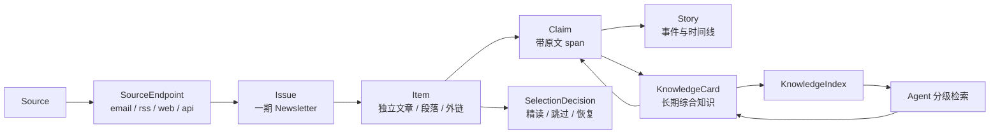

# Newsletter → Agent → LLM Wiki 信息工作流

> 调研日期：2026-08-19  
> 来源：[铁锤人《我是如何改变阅读流程并且快速涨粉 5w 的？》](https://x.com/lxfater/status/2089282028240044171)，2026-08-17  
> 阶段：完成初步产品、信源与技术可行性核查

## 执行摘要

这套方法值得 IC 学习的不是某个邮箱客户端，也不只是新增 13 个 Newsletter，而是一条从“高信噪比订阅”到“长期可复用知识”的完整路径：

1. 人工维护可信、低噪声的源池；
2. 将 Newsletter 自动归档，批量压缩成一屏候选；
3. 每天精读少量有信息增量的内容，而不是重复消费主流观点；
4. 未精读内容仍进入可检索的原始资料层；
5. 经过证据化抽取和人工审核后，增量更新长期知识库；
6. 写作 Agent 先读轻量索引，再下钻知识页和原文证据。

IC 可以支撑这套流程，但产品承诺应从“97 篇无人值守自动编译 Wiki”修正为：

> 所有内容进入不可变原始库和 Source Card；系统每天推荐 3 篇精读；只有经过人工确认的增量 diff 才更新综合 Wiki。

核心产品决定：

- Newsletter 成为一等 `Source`；
- Email、RSS、Web、API 是 `SourceEndpoint`，不是四个不同信源；
- “非共识”是阅读队列策略，不是内容真伪或质量的替代指标；
- 每日推荐同时保留 must-know 共识通道和 discovery 信息增量通道；
- 原始来源是事实基准，摘要、Claim 和 Wiki 都必须一跳回源。

## 1. 原文方法拆解

原文描述的工作流是：

```text
100+ 候选源
  → 人工筛选并按产品 / 研发 / 增长分组
  → Newsletter 自动进入专用邮箱标签并跳过收件箱
  → Agent 将约 51 封邮件压缩成一屏清单
  → 划掉重复主流观点
  → 每日精读 3 篇非共识 / 新数据 / 陌生角度
  → 其余内容进入 LLM Wiki
  → 写作时先读 index，再按需读取知识页
  → 数字、人名、日期和引语回原文核验
```

原文还建议遇到关键疑问时直接回信询问作者。对 IC 而言，邮件草拟可以成为后续能力，但外发必须由人确认，且发送权限应与内容处理 worker 隔离。

### 值得吸收

- 用主动订阅替代算法信息流，重新获得信源选择权；
- 先做跨源压缩和去重，再投入人类注意力；
- 把“是否值得精读”和“是否值得保存”分开；
- 从一开始设计长期知识沉淀，而不是只生成会过期的日报；
- 写作时采用 index-first 分级检索并回溯证据。

### 需要修正

- “非共识”不等于正确，高噪声异见可能只是在制造争议；
- “100 篇的知识量”是作者的效果表达，不是经验证的召回或学习指标；
- 邮件订阅不自动授予团队共享、模型处理、长期保存或商业再输出权利；
- 自动把大量来源改写进综合 Wiki 会放大幻觉、冲突和错误覆盖；
- 13 个源只是一个职业画像下的优质样本，不代表全球科技情报的完整覆盖。

## 2. 13 个信息源核查

分级只表示 IC 的接入优先级：T1 为结构化、持续、适合直接验证；T2 为高价值补充、低频、重复较多或授权/接入风险较高。

| 信息源 | 主要价值 | 接入方式 | 关键限制 | 建议 |
| --- | --- | --- | --- | --- |
| [One Useful Thing](https://www.oneusefulthing.org/) | AI 工作与教育的研究型分析，低频 | [RSS](https://www.oneusefulthing.org/feed)、邮件、网页 | Substack；不应镜像正文或批量长期保存 | T2 |
| [Ben's Bites](https://www.bensbites.com/) | AI Agent、工具与产品早期信号 | [RSS](https://www.bensbites.com/feed)、邮件、网页 | 免费与付费内容并存，不得绕过权限 | T1 |
| [Product Hunt](https://www.producthunt.com/) | 每日新产品原始发布流 | [Atom](https://www.producthunt.com/feed)、[GraphQL API](https://api.producthunt.com/v2/docs) | API 默认不允许商业用途、要求归因并受限流；优先验证 Atom | T1 |
| [The Batch](https://www.deeplearning.ai/the-batch) | AI 新闻与研究解读，周更 | 邮件、网页归档；无官方 RSS | DeepLearning.AI 条款偏个人非商业；仅保留摘要和链接 | T1 内容 / T2 接入 |
| [Simon Willison](https://simonw.substack.com/) | LLM、Web、Python、SQLite 等一手工程信号 | [RSS](https://simonw.substack.com/feed)、邮件、网页 | Substack 通用限制 | T1 |
| [Interconnects](https://www.interconnects.ai/) | 模型训练、开放生态和研究战略 | [RSS](https://www.interconnects.ai/feed)、邮件、网页 | 付费深度内容不可采集或再分发 | T1 |
| [Import AI](https://importai.substack.com/) | 研究、产业与政策交叉信号，周更 | [RSS](https://importai.substack.com/feed)、邮件、网页 | Substack；部分付费/提前访问内容 | T1 |
| [Ahead of AI](https://magazine.sebastianraschka.com/) | ML/LLM 工程实现与教程，低频深度 | [RSS](https://magazine.sebastianraschka.com/feed)、邮件、网页 | Substack；代码、论文需分别核验许可证 | T2 |
| [Hugging Face Daily Papers](https://huggingface.co/papers) | 每日热门论文与社区讨论 | 网页、邮件、[`/api/daily_papers`](https://huggingface.co/api/daily_papers) | API 未正式文档化，字段和稳定性需容错；论文许可证各自独立 | T1 |
| [TLDR AI](https://tldr.tech/ai) | 工作日高频 AI 综合摘要 | 邮件、[网页归档](https://tldr.tech/ai/archives) | 未发现 RSS；内容版权保留，不应镜像全文 | T1 |
| [The Rundown AI](https://www.therundown.ai/) | 工作日 AI 新闻与应用方法 | 邮件、[Beehiiv RSS](https://rss.beehiiv.com/feeds/2R3C6Bt5wj.xml) | 上线前再次确认 Feed 归属和条款 | T1 |
| [Marcus on AI](https://garymarcus.substack.com/) | AI 可靠性、治理和反方观点 | [RSS](https://garymarcus.substack.com/feed)、邮件、网页 | 观点性强，应标为评论；付费归档不可采集 | T2 |
| [Last Week in AI](https://lastweekin.ai/) | 周度回顾与漏报检查 | [RSS](https://lastweekin.ai/feed)、邮件、网页、音频 | 更新节奏不稳定，与日更综合源重复较高 | T2 |

共同限制：上述多个 Substack 源虽公开 `/feed`，但 [Substack ToS](https://substack.com/tos) 对 crawl/scrape、大量存储、复制分发和商业利用有明确限制。RSS 可访问不等于取得正文再利用许可。

IC 默认应只长期保存：来源身份、标题、作者、发布时间、canonical URL、源自带短摘要、抓取时间、内容指纹、内部评分和结构化分析。需要处理全文时采用来源级策略和保留期，不展示镜像、不绕过登录/付费墙、不向团队外再分发。

## 3. Karpathy LLM Wiki 核实

“LLM Wiki”存在一手公开说明，但它是一个供 Agent 实例化的设计模式，不是现成、完整、带明确软件许可证的产品：

- [Karpathy 原始说明](https://x.com/karpathy/status/2039805659525644595)描述 `raw/ → LLM 编译 Markdown Wiki → index/CLI 查询 → 输出重新归档`；
- [后续回复](https://x.com/karpathy/status/2039812403962253744)明确说当前不是 fully autonomous，尤其早期逐篇加入并保留 human-in-the-loop；
- [llm-wiki Gist](https://gist.github.com/karpathy/442a6bf555914893e9891c11519de94f)把系统分为 Raw sources、Wiki、Schema，操作包括 Ingest、Query、Lint；
- 中等规模可先读 `index.md` 再下钻；规模增长后可叠加类似 [qmd](https://github.com/tobi/qmd) 的 BM25、向量和重排检索。

因此，原文所说“概念、主张、开放问题卡片”是对该模式的进一步产品化解释，不是 Karpathy 唯一指定的数据模型。

## 4. 对 IC 数据模型的影响

当前的 `Source / Item / Story / Score / Digest` 只覆盖“发生了什么”，不足以表达“我们逐渐知道什么”。建议扩展为两条相互连接的视图：



### 建议新增实体

- `SourceEndpoint`：同一信源的 email/RSS/Web/API 地址、优先级和健康状态；
- `WorkspaceSubscription`：团队订阅、凭据、授权范围和过滤标签；
- `Issue`：Newsletter 的一期，保存 edition、canonical、发布时间、内容 hash 和接收时间；
- `Claim`：原子主张、作者立场、原文 span、抽取版本、置信度与核验状态；
- `Concept`：稳定术语、实体、别名与关系；
- `OpenQuestion`：由 Claim 引出的未决问题、状态和负责人；
- `KnowledgeCard`：由 Claim/Concept/OpenQuestion 组合的长期版本化页面；
- `SelectionDecision`：候选集、精读/划掉/恢复、理由、策略版本与人工覆写；
- `KnowledgeIndex`：标题、摘要、主题、更新时间、card id 的轻量物化索引；
- `SourcePolicy`：采集依据、保留、团队共享、模型处理、派生输出和商业输出权限。

`Story` 表示有时间边界的事件；`KnowledgeCard` 表示持续演化的知识。两者应互相链接，但不能合并成同一实体。

## 5. 每日筛选设计

不能把“反主流”直接当成质量。推荐先做可信度门控，再做信息增量排序。

### Claim 级处理

1. 从每个 Item 抽取带原文引用的原子 Claim；
2. BM25/embedding 召回相似 Claim；
3. 强模型判定重复、支持、限定条件不同或冲突；
4. 按独立源族而不是 URL 数量统计覆盖；
5. 相对团队过去 30–90 天知识计算新颖度。

建议指标：

- `consensus_ratio`：独立来源覆盖程度；
- `source_independence`：是否只是同稿转载或共同引用同一上游；
- `semantic_novelty`：相对团队已有知识的增量；
- `original_data`：是否带新实验、数字或一手材料；
- `perspective_distance`：与高覆盖主张的差异；
- `evidence_quality`：引用、证据和一手来源质量；
- `actionability`：对团队决策的作用。

### 双通道 Top 3

- `must_know`：至少 1 个高影响、高可信、高覆盖的共识内容；
- `discovery`：至少 2 个高新颖度、独立证据充分或视角不同的内容；
- 使用 MMR 去重，并可按产品/研发/增长主题配额；
- 被“划掉”的内容仍保留，展示重复共识、缺少新增证据等 reason code，可人工恢复。

新颖度是相对团队知识状态的个性化指标，不是普适真值；点赞和转发量也不能替代共识。

## 6. 推荐处理管线

```text
专用邮箱 / RSS / API / Web
  → MIME、HTML 和元数据解析
  → 去追踪参数、canonicalize、跨通道去重
  → 不可变 SourceDocument / Issue
  → 小模型摘要、实体与 Claim 抽取（绑定原文 span）
  → BM25 / embedding 候选召回
  → 强模型关系判定与推荐理由
  → 每日 must-know + discovery Digest
  → 未精读内容保存 Source Card
  → 人工审核受影响 KnowledgeCard 的更新 diff
  → KnowledgeIndex + BM25 + embedding 分级检索
  → 带引用写作与事实核验
```

关键原则：

- 模型只更新受影响页面的 diff，不整库重写；
- 每个输出记录内容 hash、模型、提示词、策略版本、token 和人工处置；
- 数字、人名、日期、引语必须回原文；
- 邮件正文是不可信输入，摘要 worker 不拥有发信、写邮箱或任意浏览器权限；
- 原始来源是事实基准，综合 Wiki 始终是可重建的派生物。

## 7. P0 验证计划

### E0：多端点采集

对 13 个源同时记录 Email 与可用 RSS/Web/API 的到达率、延迟、正文完整率、附件/链接解析率和重复率。

建议验收：

- `Issue` 幂等率 100%；
- 正文可解析率 ≥95%；
- 跨通道去重准确率 ≥98%；
- 单 endpoint 失败可被逐源监控发现，并能自动降级到其他 endpoint。

### E1：Issue → Item → Claim

双人标注约 100 个 Item，评估 Claim 边界、证据 span 命中率，以及数字、人名、时间、引语准确率。关键事实未绑定原文 span 时，不得进入正式 KnowledgeCard。

### E2：双通道排序回放

至少运行 10 个工作日，对比：

- baseline：权威度 + 相关性；
- candidate：must-know + discovery 双通道。

评价 `precision@3`、must-know recall、每日重复条数、节省时间、人工恢复率，以及 7 天后“漏掉后来变重要信息”的比例。

### E3：知识更新与写作检索

- 自动抽取先成为 draft；抽样检查 citation coverage、claim faithfulness、旧卡关联与冲突识别；
- A/B 比较“全库上下文”和“index → 页面 → 原文”，测 token、引用正确率、事实错误和完成时间。

## 8. 分阶段建议

### P0

- 专用收件地址或显式转发，不连接个人全量邮箱；
- Newsletter/Email 一等接入，完成 Source/Endpoint/Issue/Item 归一化；
- 不可变原始记录、provenance 和 SourcePolicy；
- Claim、SelectionDecision 和双通道 Top 3；
- 其余内容只生成 Source Card；
- 人工确认 Wiki diff；
- `index → 页面 → 原文` 检索与引用审计。

### P1

- Gmail 只读 OAuth、发件人发现和过滤规则预览；
- Concept/OpenQuestion、Claim 支持/冲突关系；
- KnowledgeCard 版本、回滚、人工 correction pin；
- BM25 + embedding + index 的并集召回；
- Story 与长期知识卡双向联动；
- 来源、token、模型成本和失败率仪表盘。

### P2

- IMAP/JMAP 和更多邮件服务；
- 多租户、自带订阅凭据、权限和保留策略；
- 跨语种 Claim 对齐与共识时间演化；
- 来源授权策略自动执行；
- 写作工作台与经人工确认的作者问询草稿。

P0 不需要图数据库；PostgreSQL + pgvector + 关系表足够验证。

## 9. 隐私、版权与商业化

- Gmail 的读取、修改和设置 scopes 属于受限权限；首版只读专用标签，过滤器由用户确认后自行创建，避免申请不必要的修改权限。参考 [Gmail API scopes](https://developers.google.com/workspace/gmail/api/auth/scopes)。
- 邮件进入模型前移除收件人、退订 token、追踪像素和个性化链接；HTML 默认不加载远程资源。
- 原始邮件只向有订阅权的 workspace 成员开放，支持保留期、来源删除和访问审计。
- 收到订阅邮件不等于获得全文再分发、团队共享或商业派生许可；每个 Source 分别记录并执行策略。
- 商业化优先采用 BYO subscription/credential：客户自己订阅，IC 售卖连接器、筛选、知识工作流和私有部署，而不是集中采购后向多个客户分发正文。
- 对外共享源库只共享 source metadata 和 connector recipe，不共享受限正文。

## 10. 当前结论

将 Newsletter/email 纳入 IC 的 P0 值得做，因为它补足了当前候选方案对高质量定向订阅、一期内容、作者身份和回信路径的表达能力。

但首个原型要验证的是“可信采集 + 跨源压缩 + 可解释 Top 3 + 可追溯 Source Card”，不是承诺全自动知识百科。只有 E0–E3 的质量指标成立，才进入综合 Wiki 的自动化与商业产品设计。

