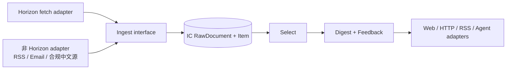

# 首轮平台基线：AIHOT / Horizon / ai-news-aggregator

> 调研日期：2026-08-19  
> 阶段：Discovery  
> 目的：校验交接清单中的首轮判断，识别 IC 的候选 seam 与实际复用范围。
> 规范影响：本报告保存研究证据；P0 interface 以后续 ADR 与数据契约为准。

## 执行摘要

首轮结论不是“fork Horizon 做完全部事情”，而是：

1. **AIHOT 是产品与数据契约标杆**。其公开产品面、REST、RSS、MCP 和 Skill 值得学习，但数据与服务不属于可自由商用的开源资产。
2. **Horizon 是 Ingest implementation 的优先验证候选**。其 fetcher、解析工具和 provider routing 值得测试；整条评分/增强/Markdown pipeline 是否复用仍需通过删除测试。
3. **ai-news-aggregator 适合帮助发现中文源和参考静态 Feed/UI**。它没有直接采集微信，公众号链路集中依赖单一第三方 RSS 镜像，且源码授权文本不完整，不宜直接作为生产依赖。
4. **IC 应拥有自己的核心数据契约和产品层**；来源 adapter 通过同一个 Ingest interface 进入规范 Item，Select 独立拥有 IC 的 Score 与 Digest 语义。

## 1. AIHOT

### 已验证

- 产品信息架构包括：精选、全部动态、热点榜与 Story、日报、主题、模型榜、Agent 接入。
- [OpenAPI v1](https://aihot.virxact.com/openapi-v1.json) 提供 Item、热点、Story、日报，以及精选 snapshot/changes 增量能力。
- RSS 包括[精选](https://aihot.virxact.com/feed.xml)、[全部公开池](https://aihot.virxact.com/feed/all.xml)和[日报](https://aihot.virxact.com/feed/daily.xml)等。
- 远程 MCP 位于 `https://aihot.virxact.com/api/mcp`，公开工具均为匿名、只读、幂等查询。
- [使用条款](https://aihot.virxact.com/terms)允许同一组织内部研究、情报、知识库和决策用途；对外商业产品、客户交付、代理接口、镜像、批量再分发和外部 RAG/模型产品需要书面授权。
- Skill 镜像中的 MIT 只覆盖 Skill 代码和文档，不覆盖 AIHOT 服务、数据库、输出数据、品牌和第三方内容。

### 值得借鉴

- `Item → Story → Storyline` 的多层信息结构；
- 同时保存 `publishedAt` 和 `discoveredAt`；
- 评分、推荐理由、原文与站内 canonical 同时展示；
- snapshot + 不透明 cursor changes + 撤选语义；
- REST / OpenAPI / RSS / MCP / Skill 共享同一只读能力面；
- ETag、缓存 TTL、Problem JSON、来源追踪和全文白名单门禁。

### 不可直接复制或依赖

- 精选库、摘要、评分、热点聚类、日报编排和模型榜数据；
- 品牌、Logo 与视觉表达；
- 未经授权将 AIHOT 作为 IC 未来对外产品的数据上游。

公开页面没有证明其内部抓取器、模型链或 T1/T1.5/T2 权重；相关描述保持为待验证。

## 2. Horizon

> 代码基线：[`main@c33d733`](https://github.com/Thysrael/Horizon/commit/c33d73330fc956b09ba5a817660e3d23cf4f132c)

### 已验证

- Python 3.11 批处理管线：配置 → 多源并发抓取 → URL 去重 → AI 分类/评分 → 阈值/主题去重/配额 → AI 增强 → Markdown → Pages/邮件/Webhook。主流程见 [`src/orchestrator.py`](https://github.com/Thysrael/Horizon/blob/c33d73330fc956b09ba5a817660e3d23cf4f132c/src/orchestrator.py#L220-L304)。
- 当前顶层定义 10 类 source，统一输出 `ContentItem`；模型定义见 [`src/models.py`](https://github.com/Thysrael/Horizon/blob/c33d73330fc956b09ba5a817660e3d23cf4f132c/src/models.py#L10-L44)。
- profile 由 JSON 与 Markdown prompt 组成，可声明丰富区块和允许工具；配置严格校验并支持环境变量。
- AI provider 覆盖 Anthropic、OpenAI/Azure、Gemini、阿里、豆包、MiniMax、DeepSeek 和 Ollama，并支持 provider chain。
- 普通 CLI 只写 Markdown 和少量 JSON；MCP run store 也只是本地分阶段 JSON，没有数据库。
- 项目没有常驻调度器；Docker 为一次性运行，cron 需调用 `scripts/daily-run.sh`，仓库内日报 workflow 当前是 `.disabled`。
- 微信不是原生 source；预设中的量子位、新智元依赖 `wechat2rss.xlab.app`。
- MIT 允许私有二开，但再分发需保留版权与许可声明。

### 工程判断

适合复用或借鉴：

- `ContentItem` 作为上游扁平内容模型的经验，但不是 IC `Item` 的规范定义；
- profile 驱动的分析与增强；
- 两阶段 AI 加工；
- MCP 分阶段产物；
- 多渠道输出。

IC 必须补齐：

- 数据库、增量状态与全文/向量检索；
- 可靠调度、任务队列、重试和逐源健康监控；
- Ingest module interface、多个来源 adapter 与逐源运行状态；
- P0 Feedback；P0.5 Story；以及后续多人协作、权限与管理界面；
- 评分、模型、提示词和内容变更的版本化审计。

### 风险

- source 执行仍硬编码在 orchestrator，新增多类国内源会放大耦合；
- RSS feed 在单个 scraper 内串行处理，规模扩大后会增加延迟；
- 单 feed 异常可能被转为空结果，难以区分“没有新内容”和“采集失败”；
- 默认 AI 并发较低，500–2,000 条/日需要重新压测和路由。

## 3. ai-news-aggregator

> 代码基线：[`main@9975f71`](https://github.com/SuYxh/ai-news-aggregator/commit/9975f71aa6e551ee1042fb117286d452f2064911)

### 已验证

- README 写 52 个公众号，源码和推荐清单实际配置 **53 个**。
- `WechatRssFetcher` 并不直接采集微信，所有公众号都映射到 `https://decemberpei.cyou/rssbox/wechat-*.xml`。实现见 [`src/fetchers/wechat-rss.ts`](https://github.com/SuYxh/ai-news-aggregator/blob/9975f71aa6e551ee1042fb117286d452f2064911/src/fetchers/wechat-rss.ts#L12-L66)。
- 对外能力是 GitHub Pages 上每两小时构建的 24h/7d 静态 JSON，不是带查询、分页、鉴权和 SLA 的 API。
- 最终 Item 主要包含来源、标题、URL、发现/发布时间和双语标题，没有正文、摘要、公众号分类或封面。
- 部分 RSS item 没有真实 `pubDate`，实现会把 channel 的 `lastBuildDate` 赋给同 feed 多篇文章，时效排序可能失真。
- 单 feed 失败被吞掉，聚合状态仍可能显示成功，缺少逐公众号健康信息。
- 仓库没有正式 `LICENSE` 文件；只有 README badge 和 `package.json` 声明 MIT，GitHub License API 返回空。

### 可借鉴

- 公众号候选清单；
- `RawItem → archive → latest snapshot` 思路；
- 24h/7d Feed 与 source status 的产品形式；
- 轻量 React 信息流交互。

### 不应直接依赖

- 单一第三方个人域名提供的公众号 RSS；
- 无 schema 版本、游标、SLA 的静态 JSON 作为唯一生产上游；
- 授权不清晰的源码或生成数据。

## 当前决策

Horizon 进入低层能力原型验证，但不会在验证前被定义为完整产品底座或整管线入口。中文源需要多个可替换 adapter 满足同一个 Ingest interface，并共享逐源监控、失败和降级语义。AIHOT 只用于学习产品与契约，并严格区分“技术可访问”与“用途获授权”。

## 下一步验证

1. 评审并冻结 P0 领域角色、ID、provenance 和 SourcePolicy；
2. 用 Horizon 与一个非 Horizon adapter 通过同一 Ingest 契约测试；
3. 验证 Newsletter 的 Email/RSS 端点、官方 RSS/API 与中文来源链路；
4. 跑通 `Ingest → Select → Digest → Feedback` tracer bullet；
5. 对 500–2,000 条/日做延迟、失败率和模型成本压测；
6. 再决定 Horizon 采用 fork、提取低层实现或按 interface 重写。
